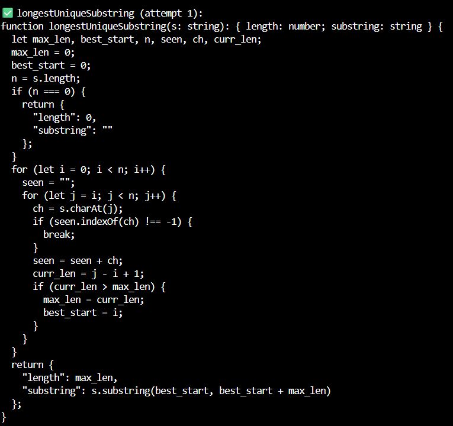

# Orkast

**Orkast** is a neuro-symbolic program synthesis engine that decouples algorithmic reasoning from target-language syntax. Instead of asking an LLM to write raw, boilerplate-heavy TypeScript or JavaScript directly, Orkast constrains a lightweight model (`gemini-3.5-flash-lite`) to assemble **indented, Scratch-like pseudocode blocks** inside a schema-locked JSON envelope (`{ "c": "..." }`). A deterministic compiler pipeline lowers those blocks into an **ESTree AST**, enforces structural sandboxing, emits canonical TypeScript via `astring`, validates types and return paths via the **TypeScript Compiler API (`tsc`)**, and executes the result under a deterministic loop-step guard against an edge-case test suite.

---

## 1. Philosophy & Problem Statement

### Why Raw Syntax Generation Fails at Scale

1. **Syntax & Boilerplate Tax:** LLMs waste expensive output tokens (typically priced ~5x–8x higher than input tokens) emitting curly braces, semicolons, type annotations, and language-specific scaffolding rather than pure logic.
2. **Context Dilution in Monolithic Agents:** Stuffing entire repositories and framework documentation into every prompt degrades small-model accuracy and inflates input costs.
3. **Unverified Hallucinations:** Free-form code generation mixes logical reasoning with syntax formatting; a single missing brace, invalid API call, or infinite loop breaks execution.

### The Orkast Approach

* **Blocks Over Syntax:** The model manipulates high-level, indentation-scoped logic primitives (`set`, `fn`, `if`/`elif`/`else`, `while`, `for ... of`, `for ... from ... to`, `return`), never target-language syntax.
* **Asymmetric Planner / Worker Split:** A smart planner (or human) defines a narrow, isolated contract (`ProgramSpec`: signature, intent, and edge-case tests), while an inexpensive Lite worker synthesizes and verifies one isolated unit at a time.
* **Deterministic Verification Gate (CEGIS):** Counterexample-Guided Inductive Synthesis loops feed exact compiler diagnostics or failing test counterexamples back to the worker until every static and runtime assertion passes.

---

## 2. Repository Architecture

```text
orkast/
├── dsl-parser.ts        # Lexer & parser lowering indented Orkast DSL blocks into an ESTree Program
├── runtime.ts           # AST sandbox walker, astring printer, virtual tsc type-checker & step-guarded V8 runner
├── dsl.ts               # Schema-locked CEGIS synthesis loop & token/cost telemetry helpers
├── orchestrator.ts      # Baseline raw-JS CEGIS orchestrator (reference implementation)
├── benchmark.ts         # Head-to-head economic & accuracy benchmark (raw-js vs. orkast-dsl)
└── test-structures.ts   # Offline smoke tests & live synthesis tests for arrays, objects, strings & nested helpers

```

---

## 3. How the Pipeline Works

Every synthesis request flows through a five-stage deterministic pipeline:

1. **Constrained Block Generation (`dsl.ts` / `test-structures.ts`)**
* Calls `gemini-3.5-flash-lite` with `responseMimeType: "application/json"` and a single-key schema (`{ "c": string }`) to prevent markdown fences or conversational drift while keeping JSON wrapper overhead to ~5 output tokens.
* Tracks `promptTokenCount` and `candidatesTokenCount` across attempts and computes price-weighted token equivalents ($W_{\text{tok}} = T_{\text{in}} + 5\,T_{\text{out}}$) and throughput per $10.


2. **Indentation Lexing & ESTree Lowering (`dsl-parser.ts`)**
* `lexLogicalLines()` strips comments/fences and merges multi-line arrays, objects, and strings so nested literals never trigger false indentation errors.
* `normalizeOperators()` converts `and`/`or`/`not` and loose `==`/`!=` into strict `&&`/`||`/`!` and `===`/`!==` outside string literals.
* `parseOrkastDsl()` translates block keywords into JavaScript control structures, parses the result via **Acorn (`ecmaVersion: 2022`)**, and walks each function scope via **`estree-walker`** to hoist `let` declarations to the top of their enclosing function—giving variables Scratch-like function-wide scope without block-scoping errors.


3. **AST Allowlist Sandbox (`runtime.ts` -> `compileESTree`)**
* Traverses the `ESTree.Program` with `estree-walker` and rejects any AST node outside `ALLOWED_ESTREE_NODES` or any blocked global/reflection identifier (`eval`, `Function`, `constructor`, `__proto__`, `prototype`, `globalThis`, `window`, `process`, `require`).


4. **Canonical Code Emission & Virtual Type-Checking (`runtime.ts`)**
* Generates clean JavaScript via **`astring`**, injects the typed TypeScript function signature, and runs **`ts.createProgram`** in-memory (`noImplicitReturns: true`, `types: []`) to verify types, property accesses, and return paths before execution.


5. **Loop-Guarded Execution & CEGIS Feedback (`runtime.ts` + `dsl.ts`)**
* Clones the verified ESTree and injects an execution counter (`__orkastSteps`, capped at `25,000` iterations) into every `while`, `do...while`, `for`, `for...of`, and `for...in` loop body so non-terminating logic fails fast with a deterministic diagnostic.
* Evaluates all test cases using deep structural equality (`node:util` `isDeepStrictEqual`), feeding any `[PARSE_ERROR]`, `[TYPE_ERROR]`, `[WRONG_OUTPUT]`, or `[RUNTIME_EXCEPTION]` back into the next synthesis attempt.


---

## 4. Orkast DSL Reference

| Construct | Orkast DSL Syntax | Lowered TypeScript / JavaScript |
| --- | --- | --- |
| **Variable & Destructuring** | `set total = 0`<br>

<br>`set [a, b] = pair`<br>

<br>`set map[key] = val` | `let total; total = 0;`<br>

<br>`let [a, b] = pair;`<br>

<br>`map[key] = val;` |
| **Nested Helper Function** | `fn clean(s):`<br>

<br>`  return s.trim()` | `function clean(s) { return s.trim(); }` |
| **Conditionals** | `if x < 0:`<br>

<br>`elif x == 0:`<br>

<br>`else:` | `if (x < 0) { ... }`<br>

<br>`else if (x === 0) { ... }`<br>

<br>`else { ... }` |
| **Range Loop** | `for i from 0 to n:` | `for (let i = 0; i < n; i++) { ... }` |
| **Iterable Loop** | `for item of items:` | `for (const item of items) { ... }` |
| **While Loop** | `while y != 0:` | `while (y !== 0) { ... }` |
| **Return & Loop Control** | `return res` / `break` / `continue` | `return res;` / `break;` / `continue;` |

---

## 5. Running & Benchmarking

Ensure `GEMINI_API_KEY` is configured in `.env` (Node.js 22+ native TypeScript execution is used throughout):

```bash
# Run head-to-head economic & accuracy benchmark (raw-js vs. orkast-dsl)
node --env-file=.env benchmark.ts

# Run offline smoke test + live structured synthesis tests (arrays, objects, strings)
node --env-file=.env test-structures.ts

```

### Measured Benchmark Snapshot (`gemini-3.5-flash-lite`)

| Benchmark Task | Mode | Attempts | Input Tokens | Output Tokens | Weighted Tokens ($T_{\text{in}} + 5T_{\text{out}}$) | Verified Tasks / $10 |
| --- | --- | --- | --- | --- | --- | --- |
| `computeTax` (slabs) | `orkast-dsl` | 1 | 248 | 103 | 763 | ~17,474 |
| `isPrime` (pure math) | `orkast-dsl` | 2 | 385 | 145 | 1,110 | ~12,012 |
| `gcd` (Euclidean) | `orkast-dsl` | 1 | 171 | 73 | 536 | ~24,875 |
| `groupAndSummarize` (objects/arrays) | `orkast-dsl` | 1 | 263 | 106 | 793 | ~16,813 |
| `longestUniqueSubstring` (strings) | `orkast-dsl` | 1 | 212 | 193 | 1,177 | ~11,328 |


---

## 6. Planned Next Extensions

* **Audit Ledger (`.orkast/runs/`):** Persist `(ProgramSpec, testSuite, attempts, latencyMs, verifiedTsCode)` JSON artifacts per verified run for human inspection and planner traceability.
* **Scoped Capability Adapters:** Inject domain-specific host functions (e.g., SQLite queries, HTTP clients, or validation helpers) into `runtime.ts` on a per-spec basis so a planner can compose multi-module systems without exposing full framework documentation to the worker model.